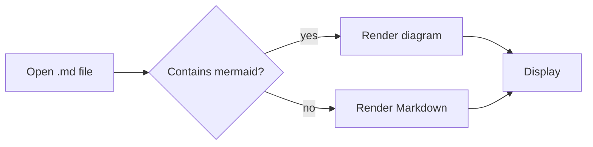
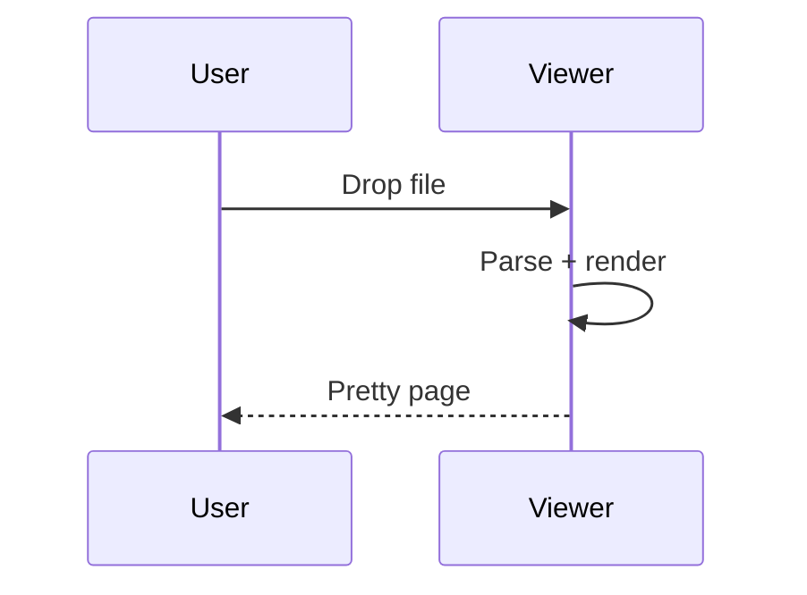
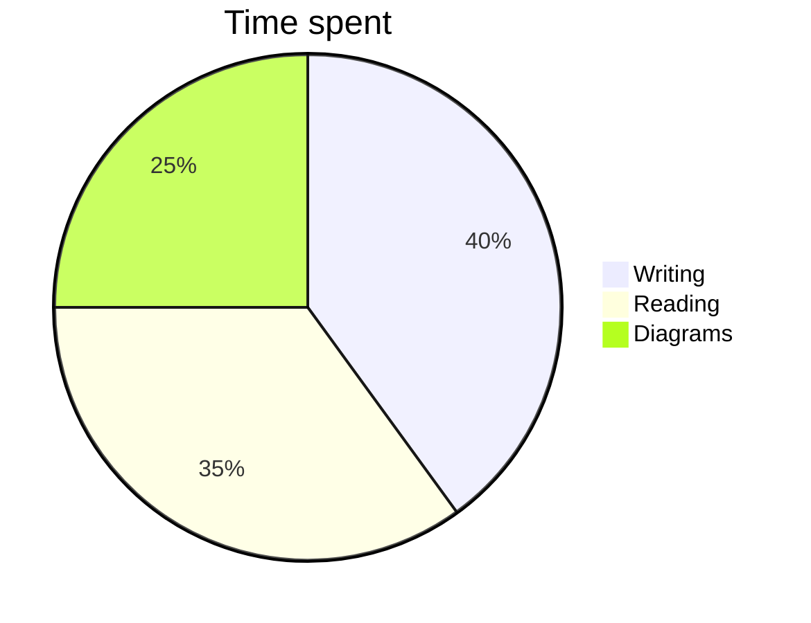

# Markdown Viewer sample

This document exercises the features the viewer supports. Edit it while it is open with `mdview` and the page refreshes automatically.

## Text formatting

**Bold**, *italic*, ~~strikethrough~~, `inline code`, and a [link to the Markdown guide](https://www.markdownguide.org). Autolinks work too: https://example.com. Press <kbd>⌘</kbd>+<kbd>V</kbd> to paste Markdown. Typographic "quotes" and dashes -- like this --- are prettified.

> A blockquote with a nested list:
> - one
> - two

> [!NOTE]
> GitHub-style alerts are supported: NOTE, TIP, IMPORTANT, WARNING, CAUTION.

> [!WARNING]
> Be careful with this one.

## Lists

1. Ordered item
2. Another item
   - Nested bullet
   - Another nested bullet
3. Last item

- [x] Completed task
- [ ] Open task
- [ ] Another open task

## Table

| Feature | Supported | Notes |
|:--------|:---------:|------:|
| Tables | ✅ | with alignment |
| Footnotes | ✅ | see below[^1] |
| Math | ✅ | KaTeX |
| Diagrams | ✅ | Mermaid |

## Code

```javascript
function greet(name) {
  console.log(`Hello, ${name}!`);
}
greet('world');
```

```python
def fib(n: int) -> int:
    return n if n < 2 else fib(n - 1) + fib(n - 2)
```

## Mermaid diagrams







## Math

Inline math: $E = mc^2$ and $\sqrt{a^2 + b^2}$.

Display math:

$$
\int_{-\infty}^{\infty} e^{-x^2}\,dx = \sqrt{\pi}
$$

## Details

<details>
<summary>Click to expand</summary>

Hidden content with **Markdown** inside.

</details>

## Images


---

[^1]: This is a footnote. Click the back arrow to return.
